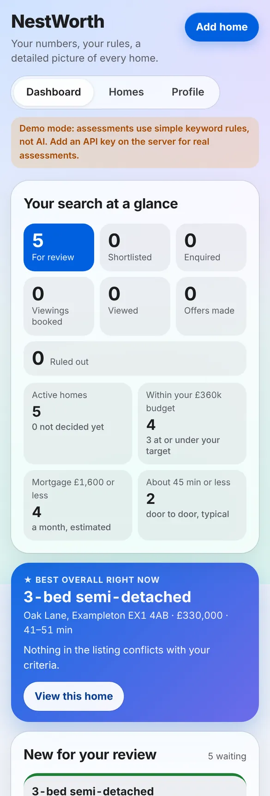
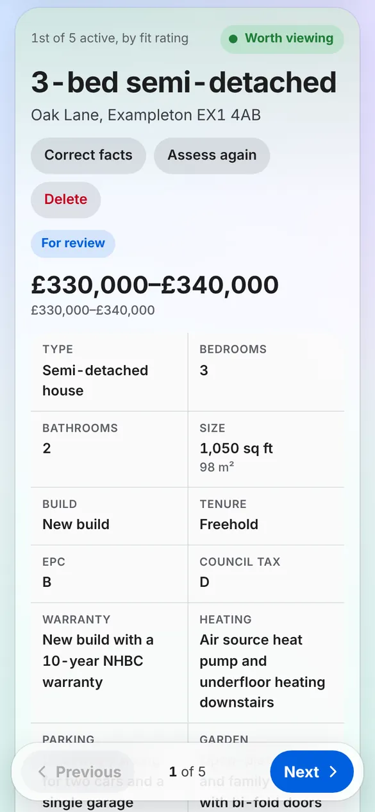
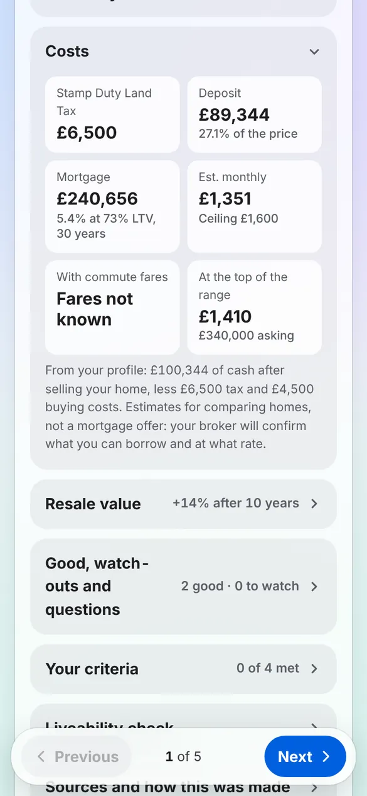
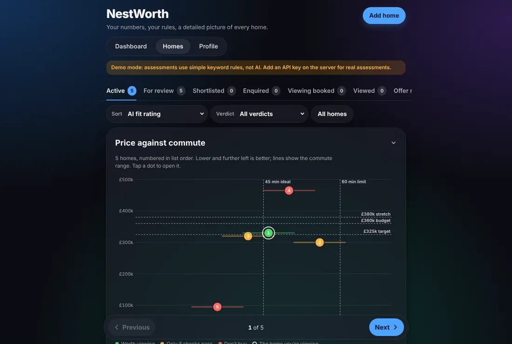
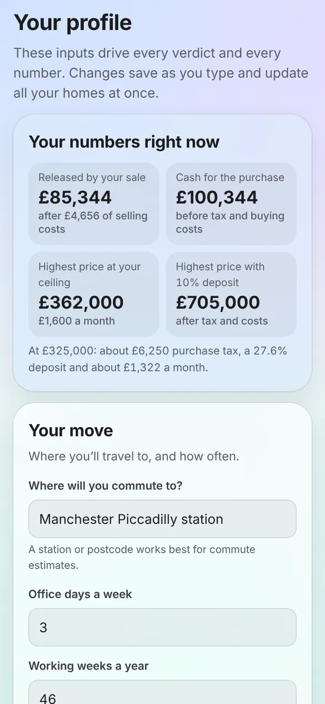

# NestWorth

**AI home-search assistant for UK buyers: your numbers, your rules, a detailed picture of every home.**

[](https://github.com/vinovee/NestWorth/actions/workflows/ci.yml)
[](https://github.com/vinovee/NestWorth/actions/workflows/codeql.yml)
[](LICENSE)
[](https://nodejs.org)

Tell NestWorth what you need and what you can afford, add property listings by link or by pasting them, and get a frank assessment of each one: checked against your own rules, with every number worked out in code rather than by the AI. You run it yourself, with your own AI key, or in demo mode with none. No accounts, no tracking: your profile, homes and notes stay in your browser.

<p>
  
  
  
</p>


> Screenshots show demo mode with fictional homes. Estimates and AI assessments can be wrong. This is not financial, mortgage or legal advice.

## Why NestWorth?

Property portals show you listings, not whether a home works for you. A general-purpose AI chat can help, but it can get the sums wrong, apply your rules differently from one listing to the next, and needs your finances pasted into the conversation.

NestWorth splits the job. The AI reads listings and judges fit; tested code does every sum and enforces your hard rules; your sale price, savings and mortgage balance never leave your browser. Every home is held to the same standard, and each verdict shows its reasons.

## What it does

- **Assesses listings against your criteria.** The AI reads a listing and returns a structured assessment: facts, a commute estimate, ratings, a verdict, what's good, what to watch, questions to ask the agent, and a check of each of your must-haves.
- **Applies your hard rules in code.** Exclusions (shared ownership, retirement, renovation projects), property types, bedrooms, budget, monthly mortgage ceiling and commute limits are enforced by the app. The AI's verdict can only be made stricter, never looser, and every change is explained.
- **Does the maths properly.** Stamp duty for England and Northern Ireland (SDLT), Scotland (LBTT) and Wales (LTT), or your own bands; the cash released by selling your current home; deposit, loan-to-value, rate band and monthly repayment; commute fares per month; resale scenarios; and how the monthly payment moves with price, sale price and rates.
- **Flags what you asked to see.** Auctions (including the Modern Method of Auction), leasehold, homes under offer, areas that may feel deserted, and listings that try to manipulate the AI.
- **Tracks your search.** For review → Shortlisted → Enquired → Viewing booked → Viewed → Offer made, or Ruled out with a reason. Notes and your own 1–10 rating per home. A dashboard shows what needs deciding and what keeps putting you off.
- **Lets you correct the AI.** Fix any key fact (price, bedrooms, commute, fares); costs, rules and verdicts update straight away.
- **Keeps your data yours.** Everything is stored in your browser. Export and import a JSON backup. Your sale price, mortgage balance and savings are never sent to the server or the AI.

## Quick start

You need [Node.js](https://nodejs.org) 22 or later (26 LTS recommended). The app has **no runtime dependencies**, so there is nothing to install to run it.

### Try it without an API key (demo mode)

```bash
git clone https://github.com/vinovee/NestWorth.git
cd NestWorth
npm run demo
```

Open <http://127.0.0.1:8787> and choose **Try it with example data**. Demo mode uses simple keyword rules instead of AI, so you can see the whole app work offline.

### With Claude

```bash
cp .env.example .env
# edit .env: set ANTHROPIC_API_KEY (and optionally ANTHROPIC_MODEL)
npm start
```

The default model is `claude-sonnet-5-5`. To research each home's area on the web as well (crime, flood risk, development, sold prices, the commute), set `WEB_RESEARCH=true`; it's slower and uses web search credits.

### With OpenAI or a local model

```bash
LLM_PROVIDER=openai
OPENAI_API_KEY=...
OPENAI_MODEL=...
# or a local model through Ollama or LM Studio:
OPENAI_BASE_URL=http://localhost:11434/v1
OPENAI_MODEL=<a model you have pulled>
```

Any server that supports the Chat Completions API with `response_format: json_schema` works. Smaller local models fail schema validation more often; the app shows the model its errors and retries up to twice, then tells you.

### With Docker

```bash
cp .env.example .env   # set your key and an APP_ACCESS_TOKEN
docker compose up --build
```

## Your inputs

Everything personal to you is an input on the **Profile** page. Changes save as you type, and every home's costs, rules and verdict update at once.



| Section | What you enter | What it drives |
|---|---|---|
| Your move | Commute destination, office days, working weeks, ideal and longest commute | Commute estimates and fares, commute rules, the chart |
| Budget | Target, maximum, stretch, monthly mortgage ceiling | Budget rules, "best overall", the chart's budget lines |
| Selling your home | Expected price, mortgage to repay, agent fee (with or without VAT), legal and other costs | Cash released for the deposit |
| Cash and buying costs | Savings, buying costs | Deposit after tax and costs |
| Mortgage | Term, and a rate for each loan-to-value band (replace the illustrative rates with your broker's quotes) | Monthly payment, deposit-too-small checks |
| Purchase tax | Nation (or your own bands), first-time buyer, moving home, still owning your old home at completion, additional property, non-UK resident | Stamp duty, LBTT or LTT, including reclaimable surcharges |
| What you're looking for | Types of home, minimum bedrooms, age and condition, must-haves, nice-to-haves, exclusions, auction and leasehold handling, areas, what you'd flex first, free-text notes for the AI | The AI's criteria check and your hard rules |
| Resale | How long you might stay; optionally your own growth assumptions | Resale scenarios |

## How the AI is used, and kept honest

The AI does what it's good at (reading messy listings, judging fit, spotting risks) and code does everything that must be exact. Details are in [docs/ai-design.md](docs/ai-design.md). In short:

- **Structured output, validated twice.** Claude returns JSON constrained to a schema (`output_config.format`); the server validates it again with the same schema, repairs small problems, and if the shape is wrong shows the model its errors and retries (up to twice).
- **No arithmetic by the model.** Tax, deposits, mortgages, fares and resale are pure, tested functions in [`src/shared/finance.js`](src/shared/finance.js).
- **Your rules in code.** [`src/shared/policy.js`](src/shared/policy.js) can only lower a verdict, and says why.
- **Untrusted text stays data.** Listings and web pages are wrapped in randomly named delimiters, the model is told to treat them as data, and attempts to steer it are flagged. An eval case checks this.
- **Citations are checked.** An assessment may only cite the listing and pages the web search actually returned; anything else is removed and you're told.
- **Data minimisation.** The AI gets your criteria and a derived price limit, never your sale price, mortgage balance or savings.
- **Provenance on every home.** Model, prompt version, date, sources, token use and any warnings are shown on each card.
- **Evals.** `npm run eval` runs fictional listings (including shared ownership, retirement, renovation, an auction, an over-budget home and a prompt-injection attempt) through the real pipeline and checks extraction, flags and final verdicts.
- **Prompts are versioned files** in [`prompts/`](prompts/), reviewed like code.

## Privacy

- The server is stateless: it stores nothing and logs no listing text, criteria or keys.
- Your profile, homes and notes live in your browser's local storage. **Export** regularly if they matter to you; clearing site data deletes them.
- When you assess a listing, its text and your search criteria go to the AI provider configured on the server, under that provider's data terms.
- "Check the commute" links open Google Maps with the listing address and your destination, only when you tap them.

## Security

- Binds to `127.0.0.1` by default. Listening on another address requires `APP_ACCESS_TOKEN` (or an explicit `ALLOW_UNAUTHENTICATED=true`).
- Per-client rate limit, daily cap and a limit on assessments running at once protect your AI budget.
- Strict Content Security Policy (no inline script or style, no third-party origins), and the UI never inserts untrusted text as HTML.
- Listing links are fetched with SSRF protection (public addresses only, checked at connection time and on every redirect), size and time limits, and respect for `robots.txt`.
- CodeQL, Dependabot and `npm audit` run in CI. See [SECURITY.md](SECURITY.md) to report a problem.

## Costs

Assessments call your AI provider with your key. With Claude Sonnet 5.5 at its list price ($2 per million input tokens and $10 per million output tokens, checked 17 November 2026) an assessment should cost a few US cents; web research adds search fees. That's an estimate: set `PRICE_INPUT_PER_MTOK` and `PRICE_OUTPUT_PER_MTOK` to log an estimated cost for every assessment, and run `npm run eval` to measure your own numbers.

## Many property sites block automated reading

Some portals' terms forbid automated access, and the app respects `robots.txt`, so a link may not work. **Pasting the listing text always works**, and is often better: include the description, key features and floor plan dimensions.

## Project layout

```
src/
  shared/      pure modules used by browser, server and tests
    finance.js   tax, deposit, mortgage, price limits, fares, resale
    tax-rules.js UK purchase tax bands, with sources and dates
    policy.js    your hard rules, applied to every verdict
    schema.js    the assessment schema (also sent to the model)
    validate.js  schema validator and wire-schema converter
    profile.js   inputs, defaults, the fictional example buyer
  server/      zero-dependency Node HTTP server
    ai/          provider adapters, prompts, the assessment pipeline
    listing/     safe link fetching, robots.txt, HTML to text
  web/         the app: plain ES modules, no build step
prompts/       versioned system prompts
evals/         evaluation cases and runner
examples/      fictional listings used by the demo, tests and evals
test/          node:test unit and integration tests
docs/          architecture, AI design, configuration, decisions
```

## Development

```bash
npm install          # dev tools only: ESLint, TypeScript, Node types
npm run dev          # restart on change (needs .env, or use npm run demo)
npm run check        # lint, type-check (JSDoc + TypeScript), tests, demo evals
npm run eval         # evals against your configured provider
npm run maintenance  # which facts (tax rules, AI prices, compliance) are due for review
```

The code is JavaScript with JSDoc types, checked by TypeScript in strict mode, so the browser runs the same files the tests check, with no bundler. See [CONTRIBUTING.md](CONTRIBUTING.md) and [docs/architecture.md](docs/architecture.md).

## Keeping NestWorth up to date

- **Dependencies.** Dependabot proposes updates to the dev tools and GitHub Actions every week, and to the Docker base image every month. CI must pass before you merge one.
- **Facts that go out of date.** Tax rules, the default AI model and its prices, the compliance mapping and the minimum Node.js version each have a review date in [`src/shared/review-dates.js`](src/shared/review-dates.js). The weekly [Maintenance workflow](.github/workflows/maintenance.yml) runs every check on the newest Node LTS, audits dependencies and opens a `maintenance` issue when something is due. `npm run maintenance` shows the same report on your machine.
- **Your own copy.** `git pull` and restart, or `docker compose up --build -d`. Your homes live in your browser, so updating the server never touches them.

GitHub pauses scheduled workflows in public repositories after 60 days without activity. If that happens, re-enable the workflow from the Actions tab.

## Limitations

- **UK first.** Tax rules cover the UK nations; elsewhere, enter your own bands or choose no tax. Currency formatting supports GBP, EUR and USD.
- **Commute times and fares are AI estimates** unless web research is on. Check them with a journey planner before you rely on them.
- **Resale figures are scenarios**, not valuations.
- **Rates in the example profile are illustrative.** Use your broker's quotes.
- **Not advice.** NestWorth helps you weigh up homes; it doesn't replace a mortgage broker, surveyor or conveyancer.

## Roadmap ideas

Journey-planner APIs for exact commute times; postcode lookups for flood, crime and broadband data; an "ask about this home" chat; comparing two homes side by side; optional sync between devices; more countries' purchase taxes.

## Project status

Early release (0.1.0). It works end to end, but expect changes between versions; notable ones are listed in the [changelog](CHANGELOG.md).

## Getting help

- **Bugs and ideas:** [open an issue](https://github.com/vinovee/NestWorth/issues/new/choose) using one of the templates. Please leave out personal details such as your address, finances, API keys or an export file.
- **Security problems:** report them privately, as described in [SECURITY.md](SECURITY.md).
- **Setting it up:** every option is explained in [docs/configuration.md](docs/configuration.md).

## Contributing

Contributions are welcome, especially bug fixes, accessibility improvements, new purchase-tax regions and eval cases. Please read [CONTRIBUTING.md](CONTRIBUTING.md) before opening a pull request. Everyone taking part agrees to follow the [code of conduct](CODE_OF_CONDUCT.md).

## Maintainer

Created and maintained by Vino Veeraiyan ([@vinovee](https://github.com/vinovee)).

## Licence

[MIT](LICENSE) © 2026 Vino Veeraiyan
