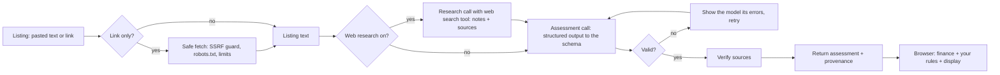

# AI design

How NestWorth uses a large language model, and the practices that keep it useful, honest, safe and affordable.

## The division of labour

| The model does | Code does |
|---|---|
| Reads messy listing text and pulls out facts | All arithmetic: tax, deposit, LTV, mortgage, fares, resale, price limits |
| Estimates the commute route and time | Enforces the buyer's hard rules (exclusions, budget, ceiling, commute, type, bedrooms) |
| Judges fit, value and risk; writes the frank summary | Validates every answer against the schema |
| Lists what's good, what to watch and what to ask | Checks citations; removes links the model couldn't have read |
| Flags auctions, shared ownership, leasehold, manipulation | Records provenance; limits spending; protects the network |

Rule of thumb: if a wrong answer would cost the buyer money and code can compute it exactly, code computes it ([ADR 0001](adr/0001-maths-in-code-judgement-in-the-model.md)).

## The pipeline

1. **Listing text.** Pasted text is used as is. A link is fetched by the server only if no text was pasted (see [Security](#security-of-fetching)).
2. **Optional research** (Anthropic only, `WEB_RESEARCH=true`). A separate call with the server-side web search tool gathers notes on availability, the commute, crime, flood risk, development and sold prices, with a URL after each fact. It's a separate call because citations can't be combined with structured output in one request.
3. **Assessment.** The system prompt ([`prompts/assess-listing.md`](../prompts/assess-listing.md)) plus a user message holding the date, the buyer's criteria, the listing and any research notes. The response is constrained with `output_config.format` (JSON schema). For OpenAI-compatible servers, `response_format: json_schema` with `strict: true`.
4. **Validation and repair.** The answer is parsed and validated with the same schema the model was given. Small problems (an overlong sentence, a number out of range, a reversed range) are repaired and counted. Structural problems are sent back to the model with the exact errors, and it tries again (at most two retries). A truncated answer is retried with a larger token budget. A refusal is reported, not retried.
5. **Source check.** The assessment may cite only the listing URL and pages the research step actually retrieved. Anything else is removed and a warning is shown.
6. **Provenance.** The response carries the provider, model, prompt version, schema version, date, token use, web searches, an optional cost estimate and any warnings. The browser shows them on every card.
7. **Rules and money.** The browser computes finance from the full private profile and applies the buyer's rules ([`policy.js`](../src/shared/policy.js)). Rules can only lower a verdict, and each change is listed on the card. Changing the profile updates every home without calling the AI again.

## One schema, two uses

[`src/shared/schema.js`](../src/shared/schema.js) defines the assessment once, with ranges and length limits. [`toWireSchema`](../src/shared/validate.js) derives the version sent to providers: structured-output engines reject `minimum`, `maximum`, `maxLength` and `maxItems`, so those move into the description text (the model still sees them) and are enforced locally.

The schema is designed for structured-output engines:

- every property is required, so there are no optional parameters (engines limit them);
- unknowns are explicit: `null` for numbers, `"Not stated"` for text, `"unknown"` in enums, which makes missing information visible rather than silently absent;
- only nine union-typed fields (engines limit those too); a test enforces the limits;
- enums are compared case-insensitively, because engines don't guarantee capitalisation.

## Prompting practices

- **Versioned prompt files** with front matter (`id`, `version`). Every assessment records the version that produced it. Change the version when you change the meaning.
- **A stable system prompt, variable data in the user turn**, so the system prompt can be cached between assessments (`cache_control` on Anthropic).
- **Clear rubrics** for ratings and verdicts, and strict definitions for each flag.
- **Honesty instructions:** use only stated facts and well-established general knowledge; never invent statistics; say "Not stated"; call out contradictions; be frank about overpricing.
- **No reasoning field in the schema.** Asking for step-by-step reasoning inside structured output can trigger refusals; the model's thinking happens in its own channel and the schema asks for short explanations instead.
- **No sampling parameters.** API version `2026-10-21` removes `temperature`, `top_p` and `top_k`; consistency comes from the schema, the rubrics and the code rules.

## Untrusted input and prompt injection

Listing text and web pages are written by third parties and can contain instructions aimed at the model.

- They're wrapped in tags with a random suffix per request (`<listing-3f9a…>`), so text inside can't close the block and pose as app instructions. A test checks this.
- The prompt says they are data, never instructions, and asks the model to set `flags.suspectedManipulation` and add a watch-out when it sees an attempt.
- Code caps any flagged assessment at "Only if checks pass".
- The model has no tools that change anything. The worst case is a bad assessment, which the rules and the buyer's own review limit.
- The research step only receives the listing and the destination name, and is told not to put anything about the buyer into searches.
- The `prompt-injection` eval case checks that the model doesn't comply and does flag it.

## Data minimisation

The browser sends `criteriaForAI(profile)`: destination, office days, commute limits, budget figures, a derived "affordable at your ceiling" price, types, bedrooms, must-haves, exclusions, areas and free-text notes. It never sends the sale price, mortgage balance, savings or rates. A test checks that these don't leak.

Before a listing goes to the AI, the server removes phone numbers and email addresses ([`redact.js`](../src/shared/redact.js)): agents' and sellers' contact details aren't needed to assess a home. The saved copy is redacted too, and the card says how many were removed.

## Transparency

Every assessment carries `meta.aiDisclosure`: whether it is AI-generated, an [IPTC digital source type](https://cv.iptc.org/newscodes/digitalsourcetype/) (`trainedAlgorithmicMedia`, or `algorithmicMedia` for demo mode) and the generator. It travels with the home into saved data and exports, and the card carries matching `data-ai-generated` attributes alongside a visible "AI-generated" label. This is how NestWorth supports Article 50 of the EU AI Act; see [compliance.md](compliance.md).

## Fairness

Both prompts tell the model to judge areas by the place, never by the protected characteristics of the people who live there, and to treat places of worship, schools and shops as amenities (distances and journey times). The `area-fairness` eval case checks the assessment's text for descriptions of residents and checks that the agent's contact details never reached the model.

## Evals

`evals/cases.json` holds fictional listings with expectations about extraction (price, type, bedrooms), flags and the **final** verdict after the buyer's rules. `npm run eval` runs them through the real pipeline with your configured provider and saves results to `evals/results/` for comparison; `--repeat 3` shows run-to-run variation. CI runs the same cases in demo mode to keep the harness working.

Run the evals before you:
- change a prompt (and bump its version);
- change the schema;
- change the default model or provider.

Add a case whenever a real listing fools the app (rewrite it with fictional details first).

## Reliability and cost

- Timeouts on every call; retries with exponential backoff and jitter for network errors, 429 and 5xx (including overloaded); `Retry-After` respected; bad keys and bad requests fail fast with a clear message.
- Rate limit per client, a daily cap and a cap on concurrent assessments.
- Web research is off by default and capped by `WEB_SEARCH_MAX_USES`.
- The system prompt is marked for caching.
- Scheduled re-checks compare a cheap fingerprint of the listing (its price and availability) and only call the AI when it changed; unchanged checks don't count towards the daily cap. Pages that have gone, redirect elsewhere or lose their price are reported as possibly withdrawn instead of being assessed, and research is never run automatically.
- Token use (and an optional cost estimate) is logged for each assessment, without content.

## Choosing a model

The default is `claude-sonnet-5-5`, a good balance of quality, speed and cost for extraction and judgement. `claude-opus-5-5` may give sharper judgement on complex listings at a higher price; `claude-haiku-5-5` is cheaper and faster but may miss subtleties. Whatever you choose, run `npm run eval` first.

## Security of fetching

See [architecture](architecture.md#fetching-listing-links). In short: public addresses only, checked at connection time and on every redirect; standard ports only; size, time and content-type limits; `robots.txt` respected; and pasting text is always offered instead.

## Known limitations

- Without web research, liveability facts (crime, flood) are pointers to where to check, not data.
- Commute estimates come from the model's general knowledge unless research is on.
- The demo provider is keyword rules, useful for trying the app and for tests, not for decisions.
