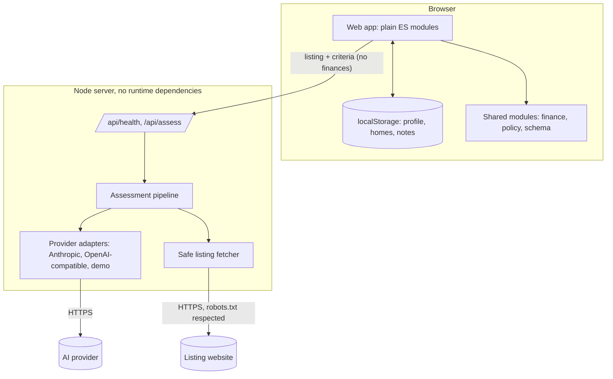

# Architecture

## Principles

1. **Local-first and stateless.** The browser owns the data; the server keeps nothing between requests ([ADR 0002](adr/0002-local-first-data.md)).
2. **Maths in code, judgement in the model** ([ADR 0001](adr/0001-maths-in-code-judgement-in-the-model.md)).
3. **No runtime dependencies, no build step** ([ADR 0003](adr/0003-no-runtime-dependencies.md)). Fewer moving parts, a smaller supply-chain surface, and code anyone can read.
4. **One source of truth.** The same `src/shared` files run in the browser, on the server and in tests.

## Code map

| Path | Role |
|---|---|
| `src/shared/finance.js` | Purchase tax, sale equity, deposit, LTV rate bands, monthly repayment, price limits, sensitivities, fares, resale |
| `src/shared/tax-rules.js` | Band data for SDLT, LBTT and LTT, with effective dates and sources |
| `src/shared/policy.js` | The buyer's hard rules; can only lower a verdict |
| `src/shared/schema.js` | Assessment and criteria schemas, enums and labels |
| `src/shared/validate.js` | Schema validator and wire-schema converter |
| `src/shared/profile.js` | Profile shape, defaults, the fictional example, `criteriaForAI` |
| `src/shared/redact.js` | Removes phone numbers and email addresses from listings before the AI sees them |
| `src/shared/fingerprint.js` | A listing's price and availability, and plain-English descriptions of changes |
| `src/shared/review-dates.js` | When tax rules, AI defaults, the compliance mapping and the Node version are next due for review |
| `src/server/app.js` | Routes, auth, same-origin checks, limits, error handling |
| `src/server/ai/assess.js` | The pipeline: fetch, redact, research, structured output, validation, repair, source check, AI disclosure; and the refresher |
| `src/server/ai/providers/*` | Anthropic Messages API, OpenAI-compatible Chat Completions, demo rules |
| `src/server/listing/*` | SSRF-safe fetcher, robots.txt, HTML to text |
| `src/web/js/*` | Store, derived values, views, dialogs and the refresh scheduler (`refresh.js`, `schedule.js`) |

## Request flow: `POST /api/assess`

1. Security headers on every response; request ID generated.
2. Same-origin check (`Sec-Fetch-Site`, `Origin`), then the access token if configured (constant-time comparison).
3. Per-client rate limit, body size limit (512 KB), JSON only.
4. Request validated against its schema (criteria included).
5. Daily cap and concurrency gate.
6. The pipeline runs with an abort signal tied to the client connection, so closing the dialog stops paying for the answer.
7. A structured log line records timings and token use, never content.

## Request flow: `POST /api/refresh`

The browser's scheduler sends a home's link and its saved fingerprint (price and availability). Steps 1 to 4 and the concurrency gate are the same as above; then:

1. The page is read with the same safe fetcher, and contact details are removed.
2. If the page has gone (404 or 410), now redirects to a different path, or no longer shows a price, the answer is "may have been withdrawn", without asking the AI to assess whatever page is there now.
3. Otherwise the new fingerprint is compared with the saved one. If nothing changed, the answer says so: no AI call, and nothing counts towards the daily cap.
4. If the price or availability changed, the daily cap is charged and the normal assessment pipeline runs; the answer lists the changes in plain English.

The browser keeps the buyer's status, notes, rating and corrections, and records each check on the home. It re-checks only active homes added by link, on the schedule in the profile, while the app is open (and catches up when it is next opened), with a pause between homes. It stops a run when the server reports a rate limit, the daily cap or a busy server.

Errors are `AppError`s with an HTTP status, a stable `code` and a plain-English message. Unexpected errors become a generic 500 and their details stay in the server log.

## Fetching listing links

`src/server/listing/fetch.js`:

- `http` and `https` only; no credentials in URLs; ports 80 and 443 only.
- Hostnames like `localhost`, single-label names and `.local`, `.internal` and similar are refused.
- DNS answers are checked **when connecting** (a custom `lookup`), so a hostname can't be switched to a private address after the URL check (DNS rebinding). Private, loopback, link-local, CGNAT, multicast, reserved, IPv4-mapped IPv6, NAT64 and similar ranges are blocked.
- Redirects are followed by hand (at most four) and each hop is checked again.
- `robots.txt` is read for each site (RFC 9309 rules, cached for an hour). If it can't be read because of a server error, the page isn't fetched.
- 15-second idle timeout, an overall deadline, a 3 MB limit after decompression, and HTML or plain text only.
- The page becomes text with the title, meta descriptions and JSON-LD structured data kept.

## The web app

- Plain ES modules served as files, no bundler. JSDoc types are checked by TypeScript.
- All DOM is built with a tiny `h()` helper that inserts text as text nodes, never HTML. Styles are set through the CSSOM. Together with the CSP (`script-src 'self'; style-src 'self'`), this blocks script injection from listing or AI text.
- Native `<dialog>` for modals and `
` for collapsible sections, for accessibility without extra code.
- Hash routes: `#/dashboard`, `#/homes/<id>`, `#/profile`.
- Derived values (finance, rules, resale) are cached per home and recomputed when the home or profile changes.

## Deployment notes

- Default bind is `127.0.0.1`. For a shared deployment put it behind HTTPS (a reverse proxy), set `APP_ACCESS_TOKEN`, and set `TRUST_PROXY=true` only if the proxy sets `X-Forwarded-For` reliably.
- The API rejects cross-site requests by comparing the browser's `Origin` with the `Host` header (or `X-Forwarded-Host` when `TRUST_PROXY=true`), so make your proxy pass the original host.
- Limits are in memory per process. With several instances, add a shared limiter in front.
- The container image runs as the unprivileged `node` user with a read-only filesystem.
